# CHMENG162-DynamicControl

- Textbook:
Process Control: Modeling, Design, and Simulation
Wayne Bequette (Publisher: Prentice Hall, 2003)

- Definition:
What is a Mathematical Model? > A model is an abstraction of reality! /  George E. P. Box(1976): All models are wrong, but some are useful

- Eykhoff (1974):
“a representation of the essential aspects of an existing system (or
a system to be constructed) which represents knowledge of that
system in a usable form”

- Dynamic model:
Mathematical description of the transient (unsteady state) behavior of a process


## Ideal Reactor Design Algorithm

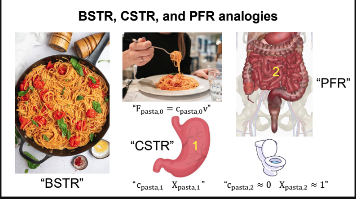
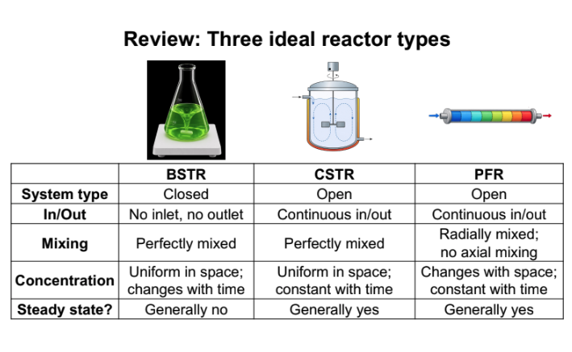
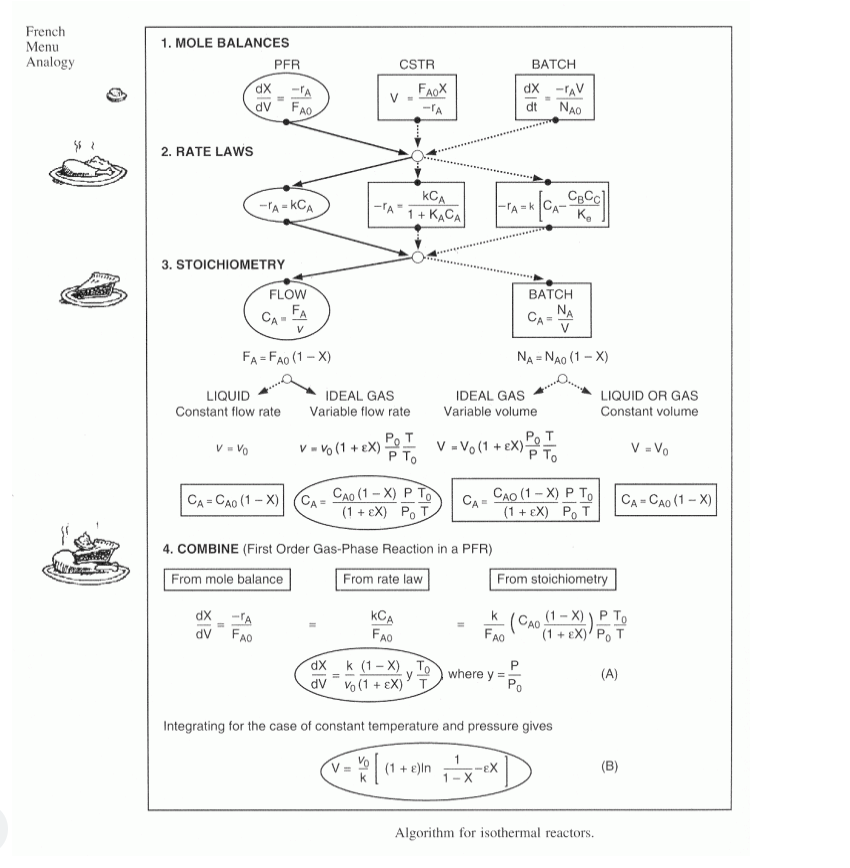


## General Procedure for Developing Dynamic Models
1. State model objective and end use (level of complexity)
2. Draw schematic diagram of process and label all process variables
3. List all assumptions (no accumulation for  steady state concentration no accumulation , Perfect mix so uniform concentration over each cross section C = C(x) , Constant reaction volume -> constant volumetric flow rate / density / cross section area / isothermal operation (k = constant) 
4. Write balance equation --> 4.1 : Write Overall mass balance , 4.2: Write Species mass / concentration / mole fraction balance , 4.3 Energy balance (if neccessary)
5. Introduce constitutive equations / What time derivation will become zero in steady state?
6. Perform degrees of freedom (Is the model solvable?)
7. Classify input as Distrurbance Variables I(What effect outcome but I cannot control)or Manipulate variable (What can I do to controk)
- **Close loop Feedback Control of liquid level** : measure CV height 

$$u(t) = \underbrace{\bar{u}}_{\text{baseline MV}} + \underbrace{K(y_{SP} - y(t))}_{\text{correction/ error}}$$

**use deviation of controlled variable to modify manipulated variable**
- **Close loop Feedforward Control of liquid level**: measure disturbance variable (what cannot be changed)
**Advantage: Cover Disturbance terms before they upset the process!**
  - 
**use deviation of disturbance variable to modify manipulated variable**


## Concepts: Define deviation terms from steady state!

- Terms: **controlled variable** (quantify the performance of final product) , **disturbance variable** (cause the control variable to deviate froom their respective set points) , **maniputate variable** (adjusted dynamically to keep the controlled variable at set points)
- Physics-based process modeling(Assumption Must be made!): Mass Balance for Blending System, Steady State Mass Balance , Possible Control Strategies (Feedforward, FeedBack),  
- Analysis of dynamical systems: What and why build models? 3 Model Approaches:
- A) Physics-based (white box) e.g Arrhenius equation $$k= Aexp(-E/RT)$$ where rate depend on temp --> Material and energy balances, Heat , Mass , momentum transfer , thermo/chem kinetics, (Scalable / expensive )
- B) Data-Driven (black box) $$\min_{\theta} \sum_{i=1}^{n} l(y_i, f(u_i; \theta))$$ (general applied, fail to extrapolate to edge case , require a large of data )
- C) Semi-Emperical : e.g Unsteady State isothermal CSTR: assumption first-order reaction (ssumption when only based on data) , assumption density of inlet and outlet stream cosntant, liquid volume constant, temp , perfect mix
- Empirical process modeling
- Feedback control and PID control design
- Direct control synthesis
- Internal model control
- Feedforward/cascade control
- Closed-loop interactions in multi-loop control systems
- Frequency-response analysis
- Statistical process control

#  Model Types: Foundations & Examples

| Model Type | Alias | Foundation | Examples & Details |
| :--- | :--- | :--- | :--- |
| **Physics-Based** | "White Box" | Governing physical laws (Mass/Energy/Momentum Balance, Thermodynamics, Chemical Kinetics).<br><br>**Core Principle:**<br>Accumulation = In − Out + Generation | **Example (Arrheniius Eq):**<br> $k = A \exp(-E_a/RT)$ |
| **Semi-Empirical** | "Gray Box" | Combines physical conservation laws with experimentally fitted relationships (e.g., balance equations from physics, kinetics from data). | **Example (Isothermal CSTR):**<br> $\frac{dC_a}{dt} = \frac{F}{V}(C_{a,in} - C_a) - kC_a$<br><br>**Assumptions:**<br>• Perfect mixing<br>• Constant volume/density<br>• Isothermal<br>• 1st-order reaction |
| **Data-Driven** | "Black Box" | Learns relationships directly from observations without requiring physical equations. Minimizes error between predicted and actual data. | **Examples:**<br>• Machine learning<br>• Neural networks<br>• Regression |

#  Definition of unsteady state, steady state and equilibium
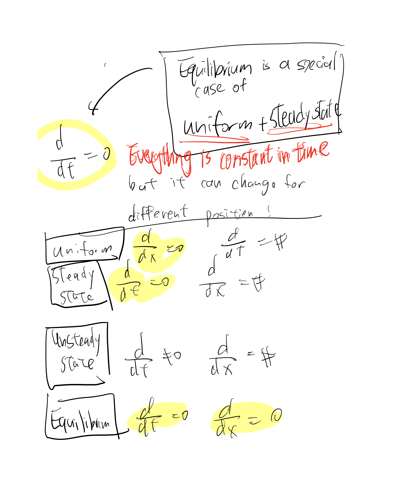


## W2 Lab 
 Ordinary Differential Equations (ODEs)

An **Ordinary Differential Equation (ODE)** describes how a dependent variable changes with respect to a single independent variable.

For example,

$$
\frac{dy}{dt} = f(t,y)
$$

where:

- $t$ = independent variable, usually time
- $y$ = dependent variable
- $\frac{dy}{dt}$ = rate of change of $y$
- $f(t,y)$ = model describing the system dynamics

### W2 Concepts
- scipy.integrate import solve_ivp for initial value problem y(0) = y_0
- Explicit and Implicit Solver: Backward Differentiation Formula
- Robertson's Stiff ODE Problem


### Examples1 : Spatial ODE iPFR in steady state
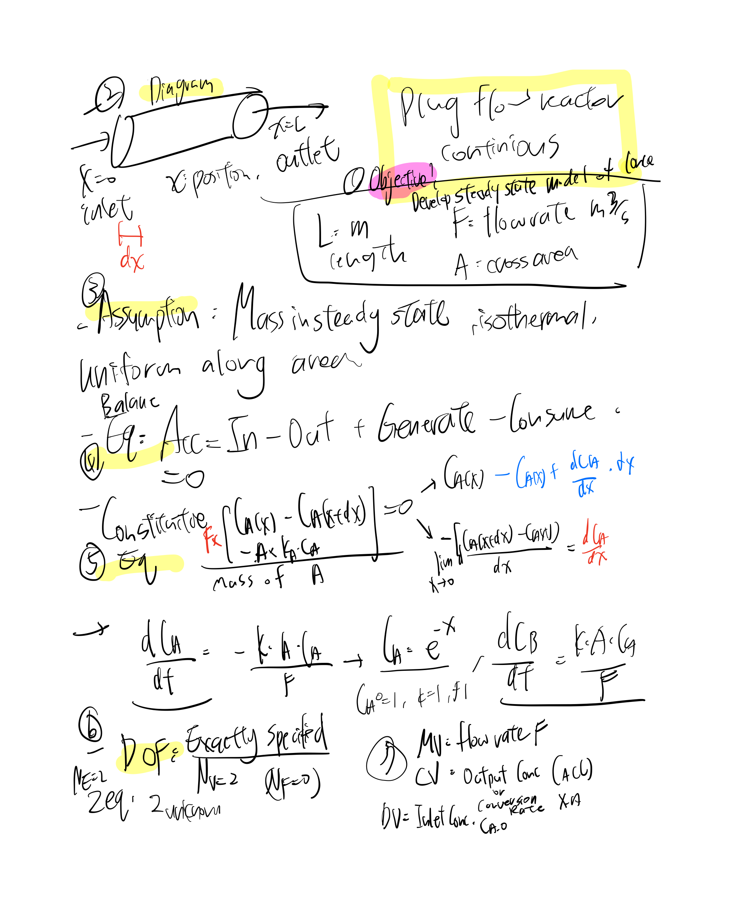


- 1.Consider a **steady-state plug flow reactor**, with flow rate $F= 1 m^3/s$ , length $L=5 m$ and cross-sectional
area $A=1 m^2$. Consider a single step first-order, irreversible reaction : $$A→B$$ Consider the initial concentration of $A$ to be $1 M$  at the inlet. Perform a component balance over a differential element $dx$ along the reactor. Assume $k=1 s^{-1}$ to be the rate constant for the reaction. Now, could you frame a first-order differential equation from this balance? Solve it and plot the concentration profile of A and B along the $x$ direction. 

- 1.1 Objective: Steady state spatial model , indepent variable is location x(0<x<L) (not time t!) 

- 1.2 Diagram and variables
 
```
x = 0                                             x = L
Inlet                                               Outlet
  |                                                   |
  v                                                   v
-------------------------------------------------------
|                                                     |
|              Plug Flow Reactor                      |
|                                                     |
-------------------------------------------------------
          ---> flow direction --->

       |---- dx ----|

       differential volume:
       dV = Ac dx
       F= Volumetric flow rate , A = reactor cross section area , k = first order rate constant
```

- **1.3 Assumptions**: steady state concentration no accumulation , uniform concentration over each cross section C = C(x) , Constant volumetric flow rate / cross section area / isothermal operation (k = constant) / reaction stoichiometry 1:1
- **1.4 Mass Balance Equations** - Acc= In - Out + Gen - Consume / Steady State : Acc = 0 
- **1.5 Constituitive Equations** $$F C_A(x)$$, 2 Methods Approach
- A)  The molar flow leaving at $x+dx$ is:
 $$F C_A(x+dx)$$ Using a **first-order Taylor expansion**: $$C_A(x+dx) \approx C_A(x) + \frac{dC_A}{dx}dx$$ Therefore, the outlet flow is: $$F \left( C_A + \frac{dC_A}{dx}dx \right)$$
- B) $$\{F(C_A(x+dx)-C_A(x))=-kC_AA_cdx}$$ and use the **definition of derivative** $$\frac{dC_A}{dx}=\lim_{dx\to0}\frac{C_A(x+dx)-C_A(x)}{dx}$$

 | Method              | Main idea                                                    | Key equation                                                   |
| ------------------- | ------------------------------------------------------------ | -------------------------------------------------------------- |
| Taylor expansion    | Approximate \(C_A(x+dx)\) using the derivative               | $$C_A(x+dx)\approx C_A(x)+\frac{dC_A}{dx}dx$$                |
| Difference quotient | Keep the inlet-outlet difference first, then take \(dx\to0\) | $$\frac{dC_A}{dx}=\lim_{dx\to0}\frac{C_A(x+dx)-C_A(x)}{dx}$$ |

- Result

$$
\frac{dC_A}{dx}=-\frac{kA_c}{F}C_A
$$

$$
\frac{dC_B}{dx}=\frac{kA_c}{F}C_A
$$


 - **1.6  Degrees of Freedom for  Unknown dependent variables**: $$C_A(x),\ C_B(x)$$ Number of unknowns: $$N_{\text{unknowns}}=2$$ Number of independent equations: $$N_{\text{equations}}=2$$ Therefore: $$DOF=N_{\text{unknowns}}-N_{\text{equations}}$$ $$DOF=2-2=0$$ Thus: $$\{DOF=0}$$ The model is fully specified and solvable.
 -   Final Analytical Solution Because: $$A_c=1,\ k=1,\ F=1$$ the concentration of A is:  $${C_A(x)=e^{-x}}$$  The concentration of B is: $${C_B(x)=1-e^{-x}}$$
 -   Spatial ODE vs. Dynamic ODE For this steady-state PFR, the model is a spatial ODE: $$\{\frac{dC}{dx}=f(C)}$$ The independent variable is position $x$. For a dynamic reactor model: $$\boxed{\frac{dC}{dt}=f(C,u)}$$ The independent variable is time $t$.

 -   **1.7 Variables**
 -   MV(what i can change): flow rate,
 -   CV (what i want to change): C_A(x) out concentration or Conversion rate
 -   DV (what i cannot change): Inlet Concentration

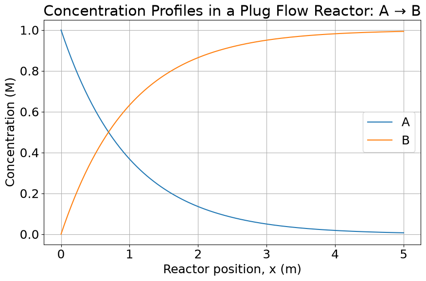

### Example 2: Well mixed time-dependent Batch Reactor (Accumulation is not zero!), with Stiff Problem 
for 2. it is a non-continious batch reactor, object is to build concentration time profile C(t), assumption is isothermal, Both reactions are irreversible. balance is also **mass accumulation = Generation, so not in steady state!**, consecutive equations are pure reaction kinetic of time since the concentration does not depend on location and volume , degree of freedom is 0 since equation =3, variable =3, DVs are concentration of C , 

```
        Batch Reactor
    ---------------------
    |                   |
    |     A → B → C     |
    |                   |
    |   Well mixed      |
    |   V = 3 m³        |
    ---------------------

        No inlet
        No outlet

        C = C(t)
```
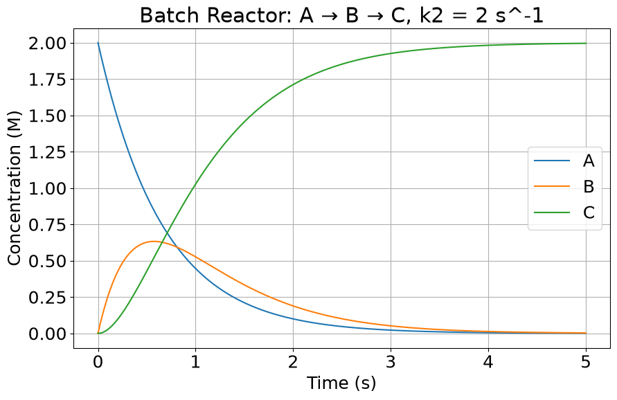
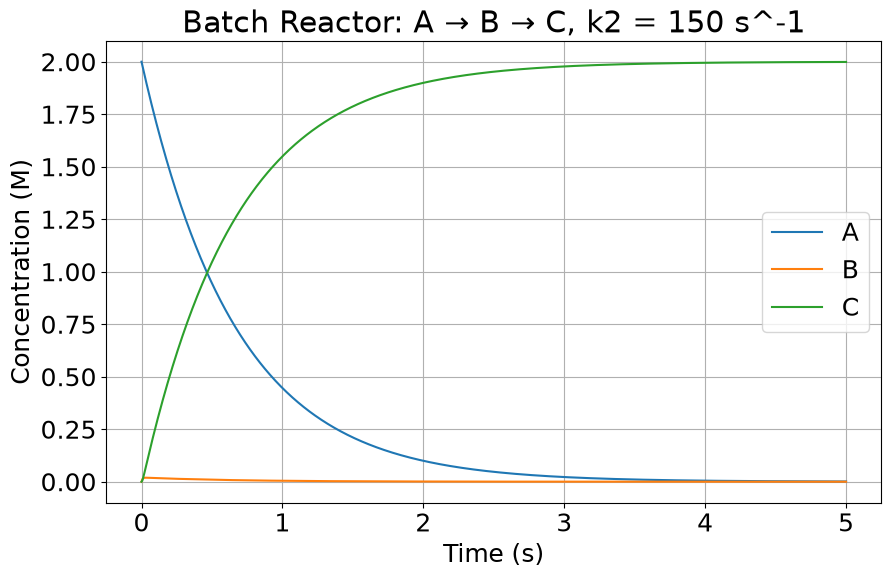

### Ex.2 Discussion : Stiff ODEs Systems 

Stiff systems are common in chemical engineering, particularly when we have reactions with a wide range of timescales including both fast and slow reactions. For these systems, standard explicit solvers require impractically small time steps to maintain numerical stability, even when the solution itself is changing slowly.

The system of ODEs we will use is a classic stiff ODE example from chemical kinetics, known as Robertson's problem. It involves three species with very different reaction rates, creating a wide range of timescales.

The system of ODEs is given by:

$$
\frac{d[X]}{dt} = -0.04[X] + 10^4[Y][Z]
$$

$$
\frac{d[Y]}{dt} = 0.04[X] - 10^4[Y][Z] - 3 \times 10^7[Y]^2
$$

$$
\frac{d[Z]}{dt} = 3 \times 10^7[Y]^2
$$

The very large rate constants ($10^4$ and $3 \times 10^7$) make this a stiff system.

### Ex.2 Discussion : Explicit vs. Implicit Solvers

The key difference between explicit and implicit solvers is how they calculate the system's state at a future time step.

An **explicit solver** calculates the state of a system at a later time from the state of the system at the **current time only**. This approach is simpler to program but is "conditionally stable," meaning it requires very small time steps to avoid instability or "exploding" solutions, particularly for stiff problems. The default solver for `solve_ivp`, `'RK45'`, is an example of an explicit solver.

An **implicit solver** finds a solution by solving an equation that involves **both the current and future states** of the system. This method is more computationally intensive per step but is "unconditionally stable" and can therefore take much larger time steps, making it much more efficient and reliable for solving stiff ODEs. The `'BDF'` (Backward Differentiation Formula) solver, available in `solve_ivp`, is an example of an implicit solver and is a good choice for stiff problems.

```
# Define the stiff ODE system (Robertson's problem)
def robertson_relaxed_ode(t, y):
    """
    Defines the system of stiff ODEs for Robertson's chemical reaction.
    y[0] = [X], y[1] = [Y], y[2] = [Z]
    """
    X, Y, Z = y
    dXdt = -0.04 * X + 1e4 * Y * Z
    dYdt = 0.04 * X - 1e4 * Y * Z - 1e7 * Y**2
    dZdt = 3e7 * Y**2
    return [dXdt, dYdt, dZdt]
# --- Attempt to solve with the default explicit solver ('RK45') ---
# We will use a relatively loose tolerance to make sure it runs without taking forever.
solution_rk45 = integrate.solve_ivp(robertson_ode, t_span, y0, method='RK45', t_eval=t_eval)

```


```
# Define the stiff ODE system (Robertson's problem)
def robertson_relaxed_ode(t, y):
    """
    Defines the system of stiff ODEs for Robertson's chemical reaction.
    y[0] = [X], y[1] = [Y], y[2] = [Z]
    """
    X, Y, Z = y
    dXdt = -0.04 * X + 1e4 * Y * Z
    dYdt = 0.04 * X - 1e4 * Y * Z - 1e7 * Y**2
    dZdt = 3e7 * Y**2
    return [dXdt, dYdt, dZdt]

solution_bdf = integrate.solve_ivp(robertson_ode, t_span, y0, method='BDF', t_eval=t_eval)


```


#  Exercise Case 1: : Unsteady-State CSTR with Radical Polymerization

A Continuous Stirred-Tank Reactor (CSTR) can be used in radical polymerization processes. Consider an isothermal CSTR that receives a feed of solvated fresh monomer $M$ with flow rate $q_{\text{in}}$ and monomer concentration $C_{M,\text{in}}$. A valve is placed on the inlet stream to the CSTR. The CSTR is not constant volume since its outlet flow varies in time as:

$$q_{\text{out}}(t) = \alpha \sqrt{h(t)}$$

where $\alpha$ is a constant and $h(t)$ is the liquid level in the tank.

---

### Chemical Reactions & Kinetics

In a propagation reaction, a unit of monomer $M$ can react with a polymer chain of length $i$ in an elementary step:

$$M + P_i \rightarrow P_{i+1}$$

For each reaction, the rate constant is the same, such that the rate of disappearance of $M$ during propagation can be written as:

$$r_M = k C_M C_{P_1} + k C_M C_{P_2} + k C_M C_{P_3} + \dots = k C_M \sum_{i=1}^{\infty} C_{P_i}$$

For convenience, we define the total polymer concentration as:

$$\gamma(t) = \sum_{i=1}^{\infty} C_{P_i}$$

The radical chain reaction is started with an initiation reaction:

$$M + * \rightarrow P_1$$

which has the following rate law:

$$r_{\text{initiation}} = k_s C_M$$

> **Note:** The reaction has no termination step (i.e., all polymer species remain reactive).

---

### Questions

* **(a)** List the potential manipulated variable(s), controlled variable(s), and disturbance variable(s) for this process.
* **(b)** Derive the model that describes the dynamics of the liquid level in the tank ($h(t)$), the concentration of monomer ($C_M(t)$), and the sum of polymer concentrations ($\gamma(t)$) as a set of three coupled ODEs. Clearly state all your modeling assumptions.

>  **Hint:** $\gamma(t)$ is not affected by the propagation reaction and is not present in the feed.

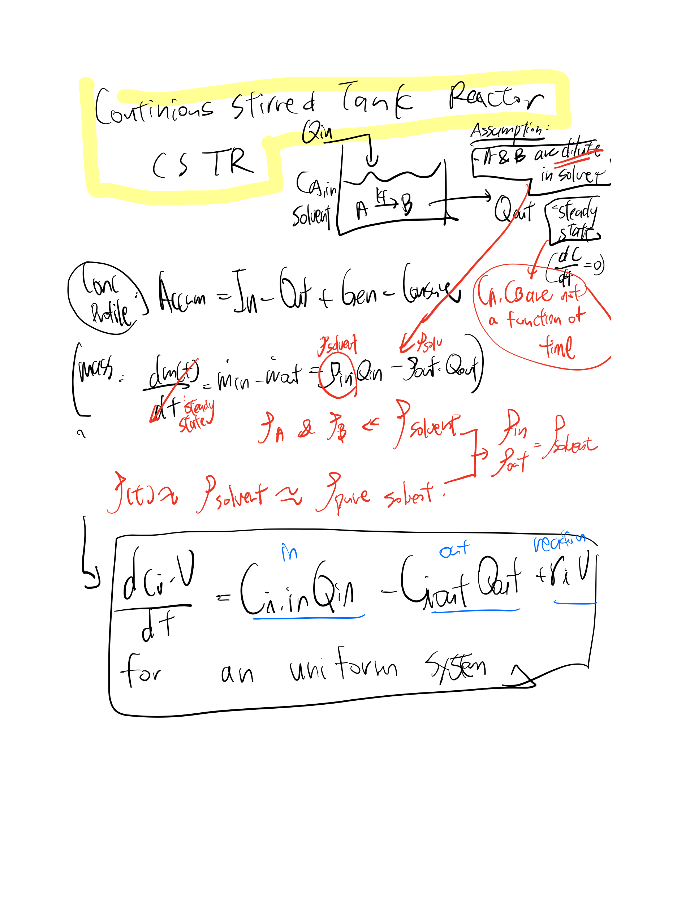
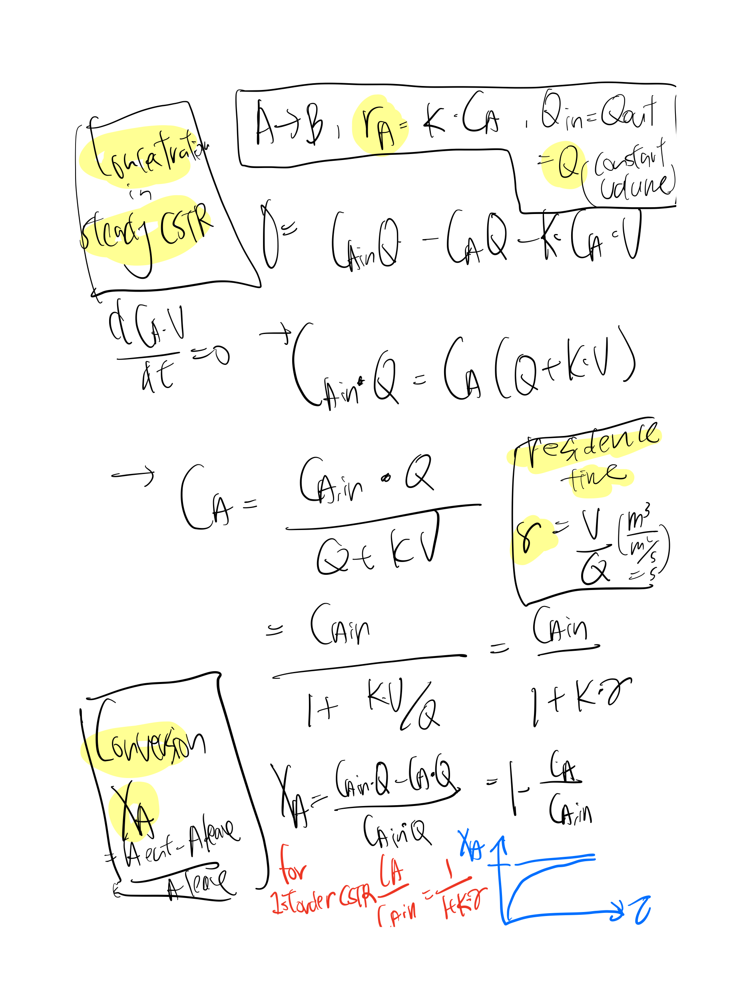
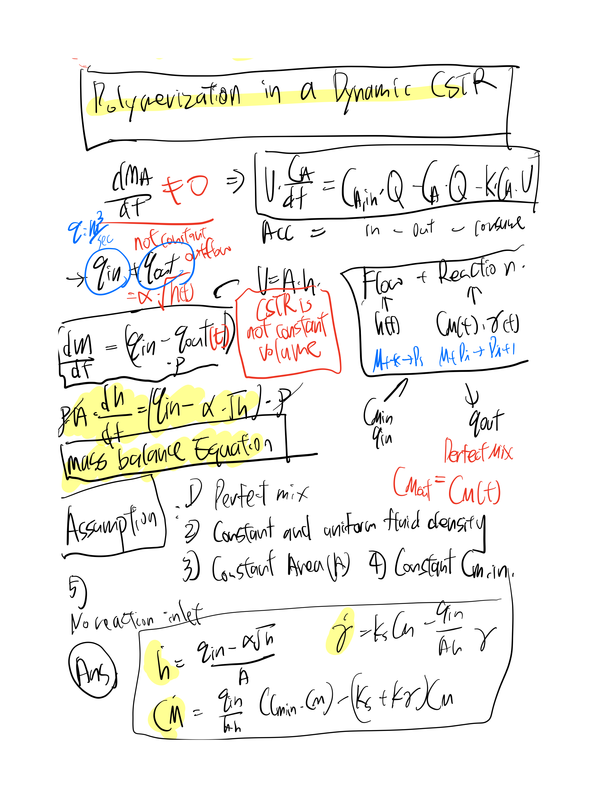
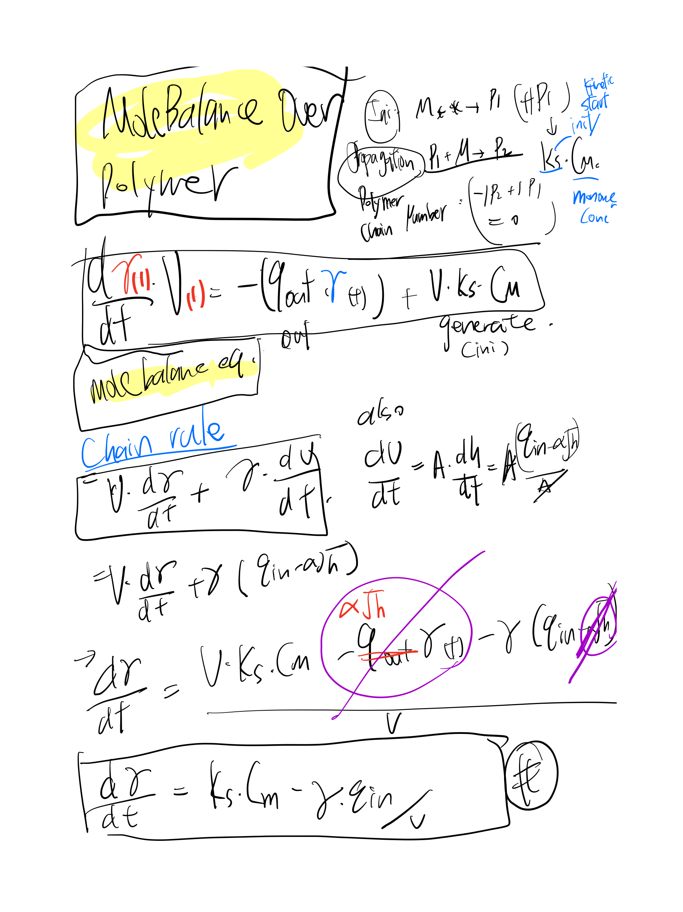
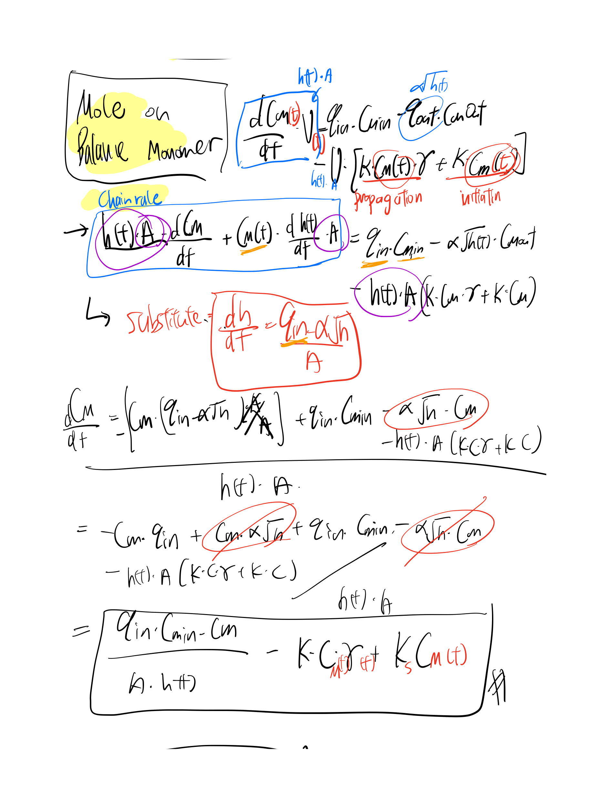

# W3: Heated Stirred Tank example with Energy Balance , Laplace Transform with unit steps

## Laplace transform is a tool to convert of function of time into a function of complex variable. - Sympy.heaviside , Sympy.laplace_transform for unit function
**Time Domain (t) → Laplace or s-Domain (s)**

The main reason we do this is that the Laplace transform converts complicated **differential equations** (in the time domain) into simple **algebraic equations** (in the s-domain).

The formal definition is:

$$
\\mathcal{L}\{f(t)\} = F(s) = \int_0^\infty e^{-st} f(t) \, dt
$$

The relationship between a system's output, $Y(s)$, and its input, $U(s)$, in the s-domain is called the transfer function, $G(s)$:
$$G(s) = \frac{U(s)}{Y(s)}$$

```python
import numpy as np
import matplotlib.pyplot as plt
import sympy as sp
from scipy import signal
t, s, a = sp.symbols('t s a')
# unit step function
gamma_t = sp.Heaviside(t)
L_gamma = sp.laplace_transform(gamma_t, t,s,noconds=True)
print("Laplace Transform of Unit Step Function γ(t):", L_gamma)

# Exponential Function
exp_at = sp.exp(-a*t) * sp.Heaviside(t)  # e^(-at) with step function
L_exp = sp.laplace_transform(exp_at, t, s, noconds=True)
print("Laplace Transform of e^(-at):", L_exp)

#Laplace Transform of Unit Step Function γ(t): 1/s
#Laplace Transform of e^(-at): 1/(a + s)


```
Laplace Transform of the Heaviside function $\gamma(t)$ is defined as:

$$
\mathcal{L}\{\gamma(t)\} = \frac{1}{s}
$$

The Laplace Transform of the exponential function $e^{-at}$ is defined as:

$$
\mathcal{L}\{e^{-at}\} = \frac{1}{s + a}
$$


# W4: Laplace Transform skills and properties: Partial fraction Expansion, Final / initial value theorem

## Exercise Case 2: Feedforward Control --> Exothermic Jacket CSTR Dynamic model that predicts concentration and temperature over time

$$\(A\rightarrow B+\Delta H_{rxn}\)$$

The inlet to the CSTR has:

* Flow rate: $F_{in}$
* Inlet concentration of species A: $C_{A,in}$
* Inlet temperature: $T_{in}$

The fluid volume in the CSTR is constant.

Assume that the inlet flow rate is constant:

$$\(F_{in}=\text{constant}\)$$

The reaction is first-order in species A, with rate constant $k$.

The reaction rate can therefore be written as:

$$\(r=kC_A\)$$

The reactor is surrounded by a cooling jacket. The jacket contains a large excess of cooling fluid, so the heat transfer between the coolant and reactor can be modeled as:

$$\(\dot Q_{cool}=UA(T_{cool}-T)\)$$

where:

* $U$ is the overall heat-transfer coefficient.
* $A$ is the heat-transfer area.
* $T_{cool}$ is the coolant temperature.
* $T$ is the reactor temperature.

The coolant temperature $T_{cool}$ can be changed by the operator.

### Solution
#### 1. constitutive equations of temperature and deviation of concentration


#### 2. New steady state after unit step change of Cooling temperature while other DVs and MVs remain constant by laplace transform and final value theorem
#### 3. Time domain response with reverse laplace transform (of New steady state after unit step change of Cooling temperature while other DVs and MVs ) 


## Exercise case 3  second-order transfer function in response to different inputs.
- because it exhibits a rich range of behaviors, including oscillatory responses, which are typical of many chemical processes.
- For chemical engineering, a transfer function like this could come from something such as a CSTR with coupled concentration and temperature dynamics.
- For example, consider an exothermic reaction
$${A\rightarrow B}\]$$
in a non-isothermal CSTR. You might have two dynamic balances:
$$\[\frac{dC_A}{dt}=\frac{q}{V}(C_{A0}-C_A)-k(T)C_A\]$$
and
$$\[\rho C_pV\frac{dT}{dt}=\rho C_pq(T_0-T)+(-\Delta H_r)Vk(T)C_A-UA(T-T_c).\]$$
Here the two dynamic variables are
$${C_A(t)\quad\text{and}\quad T(t)}$$
and because they interact, linearizing around a steady state can give a second-order transfer function.
- if the manipulated input is coolant temperature \(T_c\) and the output is reactor temperature \(T\),
$$\[T_c(t)\rightarrow \boxed{\text{CSTR}}\rightarrow T(t),\]$$
after linearization and Laplace transformation you could obtain something of the general form
$${\frac{\Delta T(s)}{\Delta T_c(s)}=\frac{\text{numerator}}{s^2+a_1s+a_0}}$$
which can then be rewritten into the standard form
$$\[\frac{K\omega_n^2}{s^2+2\zeta\omega_ns+\omega_n^2}.\]$$

```python
# --- Define Transfer Function Parameters ---
# Arbitrary values for a second-order system for demonstration
K = 1.0  # Steady-state gain
wn = 5.0  # Natural frequency
zeta = 0.5  # Damping ratio (less than 1 for an underdamped, oscillatory response)

# Define the numerator and denominator of the transfer function
# G(s) = K*wn^2 / (s^2 + 2*zeta*wn*s + wn^2)
num = [K * wn**2]
den = [1, 2 * zeta * wn, wn**2]

# Create the TransferFunction object
system = signal.TransferFunction(num, den)

print(f"Defined system G(s) = {num} / {den}")
print("-" * 30)


# --- Simulation of Different Inputs ---

# 1. Step Change Response
print("Simulating Step Response...")
t_step, y_step = signal.step(system)
print(f"Generated {len(t_step)} time points and output values for step response.")

# 2. Impulse Change Response
print("\nSimulating Impulse Response...")
t_impulse, y_impulse = signal.impulse(system)
print(f"Generated {len(t_impulse)} time points and output values for impulse response.")

# 3. Ramp Change Response
print("\nSimulating Ramp Response...")
t_ramp = np.linspace(0, 5, 200)
ramp_slope = 2.0
U_ramp = ramp_slope * t_ramp
t_out, y_ramp, _ = signal.lsim(system, U=U_ramp, T=t_ramp)
print(f"Generated {len(t_out)} time points and output values for ramp response.")

```
| Input shape | Physical example | Question being asked |
|---|---|---|
| **Step** | $T_c: 290 \rightarrow 295\ \text{K}$ | How does the reactor settle to a new state? |
| **Impulse** | Brief pulse of A | How does the reactor recover from a short disturbance? |
| **Ramp** | $T_c$ increases at $0.5\ \text{K/min}$ | Can the reactor follow a changing condition? |


Laplace Transform of Unit Step Function γ(t): 1/s
Laplace Transform of e^(-at): 1/(a + s)
Laplace Transform of γ(t): 1/s
Laplace Transform of e^(-at): 1/(a + s)
Laplace Transform of aγ(t) + be^(-at): a/s + b/(a + s)
Expected result using linearity (a/s + b/(s+a)): a/s + b/(a + s)
Transfer function: G(s) = 0.6667 / (s + 0.3333)
Initial steady-state liquid level (h_s): 4.00 m
Steady-state gain (K): 0.67
Time constant (tau): 0.33 s

Observations:
1. Step Change: Level rises and settles at a new steady state above h0.
2. Impulse Change: Level spikes then decays back to the steady state.
3. Ramp Change: Level follows a ramp with a lag (constant offset).

## W7: Dynamics of Second-Order and Higher-Order Systems

```
%pip install control
import control as ct
def plot_second_order_responses(Kp, tau, zeta_values, title):
    """
    Generates and plots the step responses for a second-order system
    with varying damping coefficients (zeta).

    Args:
        Kp (float): The process gain.
        tau (float): The natural period (time constant).
        zeta_values (list): A list of damping coefficients to plot.
        title (str): The title for the plot.
    """
    plt.figure(figsize=(12, 7))

    # Define a time vector for the simulation
    time_vector = np.linspace(0, 100, 1000)

    # Loop through each zeta value, create the system, and plot its step response
    for zeta in zeta_values:
        # Define the numerator and denominator of the transfer function
        numerator = [Kp]
        denominator = [tau**2, 2 * zeta * tau, 1]

        # Create the transfer function model
        system = ct.tf(numerator, denominator)

        # Calculate the step response
        time, response = ct.step_response(system, T=time_vector)

```


# Chemostat Bioreactor: Nonlinear Dynamics and Linearization

**Substrate-limited microbial growth in a continuous stirred-tank reactor (CSTR)**

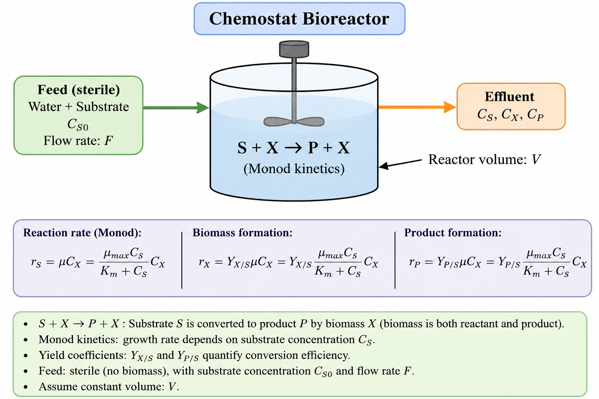


This project models substrate consumption, biomass growth, and product formation in a chemostat. It compares a **nonlinear Monod-kinetics model** integrated with SciPy against a **first-order linearized state-space model** simulated with `python-control`.


## Concepts

Monod kinetics · Chemostat/CSTR · Substrate utilization · Microbial growth · Yield coefficients · Dynamic species balances · Nonlinear coupled ODEs · Steady states and washout · First-order Taylor linearization · Jacobian matrices · Deviation variables · State-space systems · Step responses · Eigenvalues and stability · Numerical ODE integration · Nonlinear versus linear model validation

## Governing equations

### Monod kinetics and substrate consumption
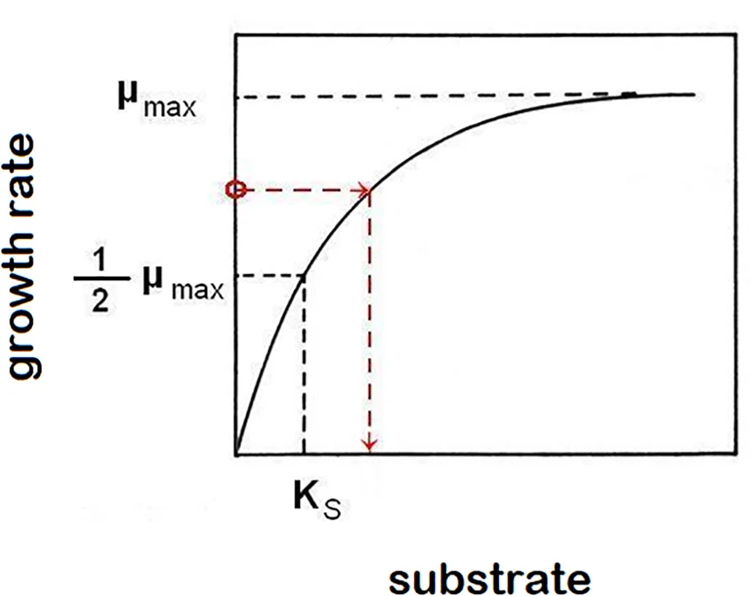


The substrate consumption rate is modeled as

$$
\boxed{r=-r_S=\mu(C_S)C_X=\frac{\mu_{\max}C_S}{K_m+C_S}C_X}
$$

where:

- $r$: positive volumetric substrate consumption rate, g/(L·h).
- $C_S$: substrate concentration, g/L.
- $C_X$: biomass concentration, g/L.
- $\mu_{\max}$: maximum **substrate-specific utilization coefficient** in this model, h⁻¹.
- $K_m$: half-saturation constant, g/L, giving $\mu(K_m)=\mu_{\max}/2$.

> **Model convention:** Here, $\mu C_X$ denotes **substrate consumption**, and biomass production is $Y_{X/S}\mu C_X$. Accordingly, $\mu$ should not be confused with the usual biomass-specific growth rate $\mu_g=Y_{X/S}\mu$. This distinction ensures the rate and yield equations are consistent.

**Substrate-limited regime** ($C_S\ll K_m$):

$$
r\approx\frac{\mu_{\max}}{K_m}C_SC_X
$$

The rate is first-order in each concentration (second-order overall).

**Substrate-saturated regime** ($C_S\gg K_m$):

$$
r\approx\mu_{\max}C_X
$$

The rate becomes approximately independent of substrate concentration.

### Biomass and product formation

Assuming constant yield coefficients,

$$
\begin{aligned}
r_X &=Y_{X/S}r=Y_{X/S}\frac{\mu_{\max}C_S}{K_m+C_S}C_X\\
r_P &=Y_{P/S}r=Y_{P/S}\frac{\mu_{\max}C_S}{K_m+C_S}C_X
\end{aligned}
$$

with

$$
Y_{X/S}=\frac{r_X}{-r_S},\qquad Y_{P/S}=\frac{r_P}{-r_S}.
$$

### Dynamic material balances

For a constant-volume, perfectly mixed reactor, define the dilution rate as

$$
D=\frac{F}{V}\quad[\mathrm{h}^{-1}].
$$

Assuming no biomass or product in the inlet stream,

$$
\boxed{
\begin{aligned}
\frac{dC_S}{dt}&=D(C_{S0}-C_S)-r\\
\frac{dC_X}{dt}&=-DC_X+Y_{X/S}r\\
\frac{dC_P}{dt}&=-DC_P+Y_{P/S}r
\end{aligned}}
$$

Here $C_{S0}$ is the substrate concentration in the inlet stream.

## Process variables and parameters

| Category | Variable | Description |
|---|---|---|
| Manipulated input (MV) | $C_{S0}$ | Feed substrate concentration |
| Controlled/observed outputs (CVs) | $C_S$, $C_X$, $C_P$ | Reactor substrate, biomass, and product concentrations |
| Potential disturbances (DVs) | $D$, kinetic parameters | Dilution-rate changes or parameter variations (held fixed in this simulation) |

| Parameter | Value | Units |
|---|---:|---|
| Dilution rate, $D$ | 1.0 | h⁻¹ |
| Biomass yield, $Y_{X/S}$ | 0.6 | g biomass/g substrate |
| Product yield, $Y_{P/S}$ | 0.05 | g product/g substrate |
| Utilization coefficient, $\mu_{\max}$ | 2.0 | h⁻¹ |
| Half-saturation constant, $K_m$ | 0.5 | g/L |
| Initial feed concentration, $C_{S0}$ | 3.0 | g/L |
| Feed concentration after step | 2.8 | g/L |
| Simulation horizon | 30 | h |

## Steady-state calculation

At a non-washout steady state ($C_{X,ss}\ne 0$), the biomass balance gives

$$
0=-DC_{X,ss}+Y_{X/S}\frac{\mu_{\max}C_{S,ss}}{K_m+C_{S,ss}}C_{X,ss}.
$$

Divide by $C_{X,ss}$ and rearrange:

$$
D=Y_{X/S}\frac{\mu_{\max}C_{S,ss}}{K_m+C_{S,ss}}
$$

$$
\boxed{C_{S,ss}=\frac{DK_m}{Y_{X/S}\mu_{\max}-D}}
$$

With the specified parameters,

$$
C_{S,ss}=\frac{(1)(0.5)}{(0.6)(2)-1}=\boxed{2.5\ \mathrm{g/L}}.
$$

From the substrate steady-state balance,

$$
\boxed{C_{X,ss}=Y_{X/S}(C_{S0}-C_{S,ss})}
$$

$$
C_{X,ss}=0.6(3-2.5)=\boxed{0.3\ \mathrm{g/L}}.
$$

From the product steady-state balance,

$$
\boxed{C_{P,ss}=Y_{P/S}(C_{S0}-C_{S,ss})}
$$

$$
C_{P,ss}=0.05(3-2.5)=\boxed{0.025\ \mathrm{g/L}}.
$$

Therefore the pre-step equilibrium is

$$
\boxed{\mathbf y_{ss}=\begin{bmatrix}2.5&0.3&0.025\end{bmatrix}^{T}\ \mathrm{g/L}}.
$$

> The non-washout solution requires $Y_{X/S}\mu_{\max}>D$ and $C_{S0}>C_{S,ss}$. A washout steady state ($C_X=C_P=0$, $C_S=C_{S0}$) also exists.

## Nonlinear dynamic simulation

At $t=0$, the feed concentration decreases from **3.0 to 2.8 g/L**. The initial reactor concentrations remain at their pre-step steady-state values:

$$
\mathbf y(0)=\begin{bmatrix}2.5&0.3&0.025\end{bmatrix}^{T}\ \mathrm{g/L}.
$$

The initial consumption rate is

$$
r(0)=\frac{2(2.5)(0.3)}{0.5+2.5}=0.5\ \mathrm{g/(L\cdot h)}.
$$

Immediately after the step,

$$
\begin{aligned}
\left.\frac{dC_S}{dt}\right|_{0^+}&=1(2.8-2.5)-0.5=\boxed{-0.2}\\
\left.\frac{dC_X}{dt}\right|_{0^+}&=-0.3+0.6(0.5)=\boxed{0}\\
\left.\frac{dC_P}{dt}\right|_{0^+}&=-0.025+0.05(0.5)=\boxed{0}
\end{aligned}
$$

All derivatives have units g/(L·h).

### Numerical integration: Runge–Kutta

The system is written as

$$
\dot{\mathbf y}=f(t,\mathbf y,C_{S0}),\qquad
\mathbf y=\begin{bmatrix}C_S&C_X&C_P\end{bmatrix}^{T}.
$$

`scipy.integrate.solve_ivp` uses adaptive RK45 integration by default. For reference, one *fixed-step* classical fourth-order Runge–Kutta (RK4) update is

$$
\begin{aligned}
\mathbf k_1 &= f(t_n,\mathbf y_n)\\
\mathbf k_2 &= f(t_n+h/2,\mathbf y_n+h\mathbf k_1/2)\\
\mathbf k_3 &= f(t_n+h/2,\mathbf y_n+h\mathbf k_2/2)\\
\mathbf k_4 &= f(t_n+h,\mathbf y_n+h\mathbf k_3)\\
\mathbf y_{n+1}&=\mathbf y_n+\frac h6(\mathbf k_1+2\mathbf k_2+2\mathbf k_3+\mathbf k_4).
\end{aligned}
$$

> RK4 is shown conceptually; `solve_ivp(method="RK45")` uses an **adaptive embedded 5(4) pair**, not these exact fixed-step equations. `t_eval` specifies requested output times, not the internal integration step.

```python
import numpy as np
from scipy.integrate import solve_ivp

D = 1.0
Y_XS = 0.6
Y_PS = 0.05
mu_max = 2.0
Km = 0.5
Cs0_initial = 3.0

Cs_ss = D * Km / (Y_XS * mu_max - D)
Cx_ss = Y_XS * (Cs0_initial - Cs_ss)
Cp_ss = Y_PS * (Cs0_initial - Cs_ss)
y_ss = np.array([Cs_ss, Cx_ss, Cp_ss])


def nonlinear_ode(t, y, Cs0):
    Cs, Cx, Cp = y
    r = mu_max * Cs * Cx / (Km + Cs)
    return [
        D * (Cs0 - Cs) - r,
        -D * Cx + Y_XS * r,
        -D * Cp + Y_PS * r,
    ]


def simulate_nonlinear(Cs0_after=2.8, t_end=30):
    t = np.linspace(0, t_end, 1501)  # Output spacing = 0.02 h
    solution = solve_ivp(
        nonlinear_ode, (0, t_end), y_ss,
        args=(Cs0_after,), t_eval=t,
        method="RK45", rtol=1e-10, atol=1e-12,
    )
    if not solution.success:
        raise RuntimeError(solution.message)
    return t, solution.y
```

`args=(Cs0_after,)` tells SciPy to evaluate `nonlinear_ode(t, y, Cs0_after)` at every solver call.

## Taylor linearization

Linearize the reaction rate $r(C_S,C_X)$ around the initial steady state. Introduce deviation variables

$$
\overline C_i=C_i-C_{i,ss},\qquad \overline C_{S0}=C_{S0}-C_{S0,initial}.
$$

The first-order expansion is

$$
\overline r\approx
\left.\frac{\partial r}{\partial C_S}\right|_{ss}\overline C_S+
\left.\frac{\partial r}{\partial C_X}\right|_{ss}\overline C_X
=k\overline C_S+b\overline C_X,
$$

where

$$
\boxed{
\begin{aligned}
k&=\frac{\mu_{\max}K_mC_{X,ss}}{(K_m+C_{S,ss})^2},\\
b&=\frac{\mu_{\max}C_{S,ss}}{K_m+C_{S,ss}}.
\end{aligned}}
$$

The linearized balances are

$$
\boxed{
\begin{aligned}
\frac{d\overline C_S}{dt}&=-(D+k)\overline C_S-b\overline C_X+D\overline C_{S0}\\
\frac{d\overline C_X}{dt}&=Y_{X/S}k\overline C_S+(-D+Y_{X/S}b)\overline C_X\\
\frac{d\overline C_P}{dt}&=Y_{P/S}k\overline C_S+Y_{P/S}b\overline C_X-D\overline C_P.
\end{aligned}}
$$

Only $C_{S0}$ changes in this scenario; hence $\overline D=0$.

## State-space model

Define the state vector and input:

$$
\overline{\mathbf x}=\begin{bmatrix}\overline C_S&\overline C_X&\overline C_P\end{bmatrix}^{T},
\qquad u=\overline C_{S0}.
$$

Then

$$
\boxed{\dot{\overline{\mathbf x}}=A\overline{\mathbf x}+Bu,\qquad
\mathbf y_{dev}=C\overline{\mathbf x}+Eu}
$$

where

$$
A=\begin{bmatrix}
-D-k&-b&0\\
Y_{X/S}k&-D+Y_{X/S}b&0\\
Y_{P/S}k&Y_{P/S}b&-D
\end{bmatrix},\qquad
B=\begin{bmatrix}D\\0\\0\end{bmatrix},
$$

$$
C=I_3,\qquad E=\mathbf 0_{3\times 1}.
$$

Numerically,

$$
\boxed{A=\begin{bmatrix}
-1.033333&-1.666667&0\\
0.020000&0&0\\
0.001667&0.083333&-1
\end{bmatrix},\quad
B=\begin{bmatrix}1\\0\\0\end{bmatrix}}
$$

| Matrix | Interpretation |
|---|---|
| $A$ | Coupling between concentration deviations and their time derivatives |
| $B$ | How the feed-substrate input enters the dynamics |
| $C=I_3$ | Outputs all three state deviations |
| $E=0$ | No instantaneous input-to-output feedthrough |

`E` is used for the feedthrough matrix, conventionally called `D` in control theory, to avoid confusion with the reactor dilution rate `D`.

```python
import control as ct

b = mu_max * Cs_ss / (Km + Cs_ss)
k = mu_max * Km * Cx_ss / (Km + Cs_ss)**2

A = np.array([
    [-D - k, -b, 0],
    [Y_XS * k, -D + Y_XS * b, 0],
    [Y_PS * k, Y_PS * b, -D],
])
B = np.array([[D], [0], [0]])
C = np.eye(3)
E = np.zeros((3, 1))

system = ct.ss(A, B, C, E)
```

## Linear step response

For a feed change from 3.0 to 2.8 g/L,

$$
\Delta C_{S0}=2.8-3.0=-0.2\ \mathrm{g/L}.
$$

`ct.step_response()` computes the response to a **unit step** input and zero initial state deviations. Scale that response by $\Delta C_{S0}$, then add the initial steady state back to obtain absolute concentrations.

```python
def simulate_linear(t, Cs0_after=2.8):
    delta_Cs0 = Cs0_after - Cs0_initial
    response = ct.step_response(system, T=t)

    # With one input and three outputs, squeeze=True gives (3, len(t)).
    y_unit_step = np.asarray(response.outputs)
    y_unit_step = y_unit_step.reshape(3, -1)

    y_deviation = delta_Cs0 * y_unit_step
    y_linear = y_ss[:, None] + y_deviation
    return y_linear
```

**Equivalent alternative:** Use `ct.forced_response(system, T=t, U=delta_Cs0 * np.ones_like(t))` to apply the input directly. Both functions simulate the **linear state-space model**, not `nonlinear_ode()`.

## Comparison and results
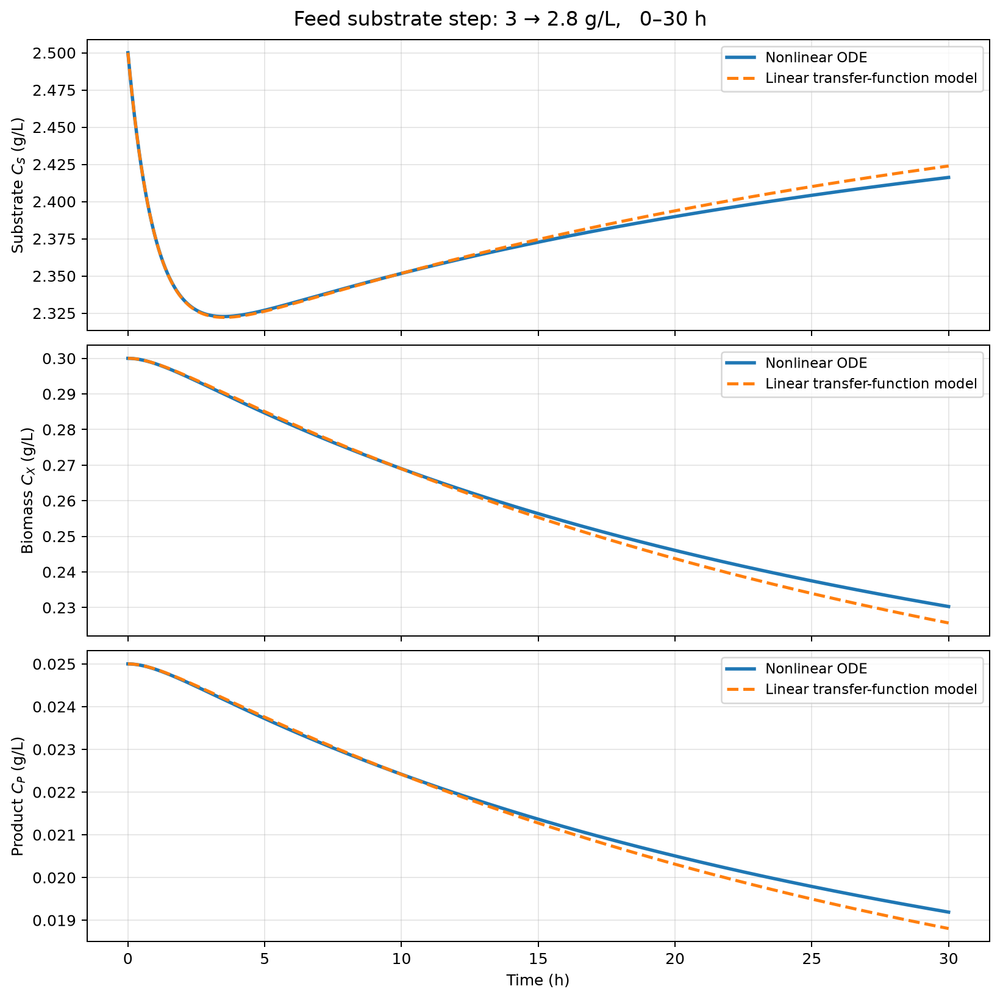
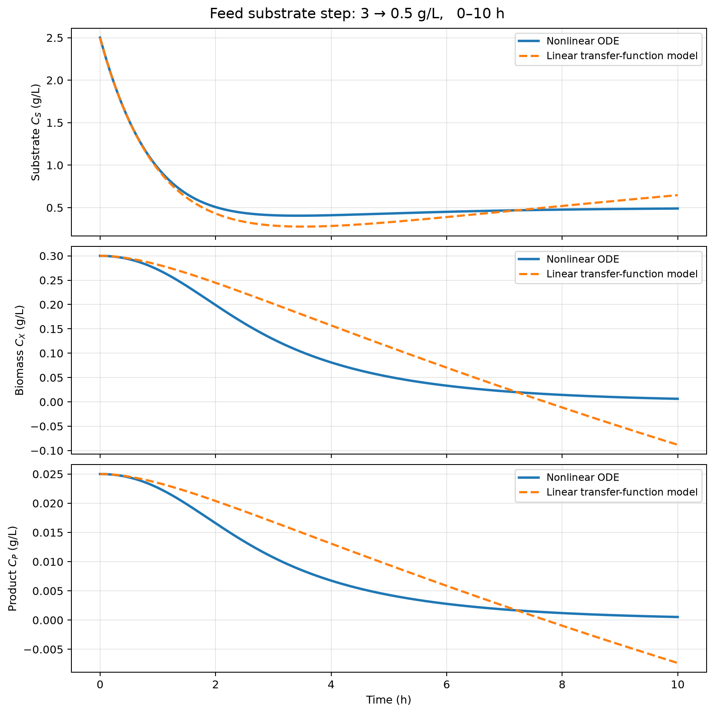


### Values reported in the original notes

| Scenario | Model | $C_S$ (g/L) | $C_X$ (g/L) | $C_P$ (g/L) |
|---|---|---:|---:|---:|
| Part E (feed step to 2.8 g/L) | Nonlinear | 2.416201 | 0.230280 | 0.019190 |
| Part E (feed step to 2.8 g/L) | Linear | 2.423887 | 0.225668 | 0.018806 |
| Part F (input not specified in source notes) | Nonlinear | 0.489588 | 0.006316 | 0.000526 |
| Part F (input not specified in source notes) | Linear | 0.647019 | -0.088143 | -0.007345 |

The Part E results demonstrate reasonable agreement for a modest input change. The Part F results indicate that **linearization may become physically invalid for sufficiently large disturbances**, producing negative predicted biomass and product concentrations. Because the original notes do not specify the Part F input, that case is reported but not reproduced in the runnable example.

the input disturbance moves the reactor farther from that point.


## Physical Interpretation
We see that the linear model does a very good job of capturing the qualitative behavior in
part (e) as the tested perturbation was relatively small. It did a much poorer job in part
(f), and it even failed to account for the fact that biomass and product concentrations
cannot be negative. We can confidently use the linear transfer function models with small
process perturbations, but not large ones.
Physically, when we decrease the substrate concentration steady state, there are more cells
in the chemostat than the substrate concentration can support. This causes the cells to
die off. In part (e), when cells die off, the substrate is consumed at a lower rate, which
ends up increasing the concentration of substrate in the chemostat, which returns to a new
steady state. In part (f), there is not enough substrate in the feed to support any cells in
the bioreactor at all, so the cell biomass concentration approaches zero.

